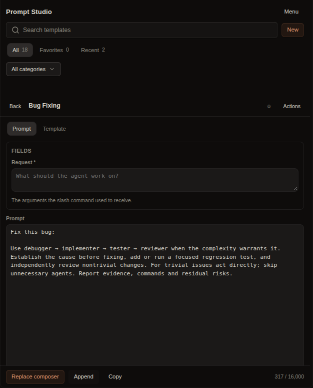
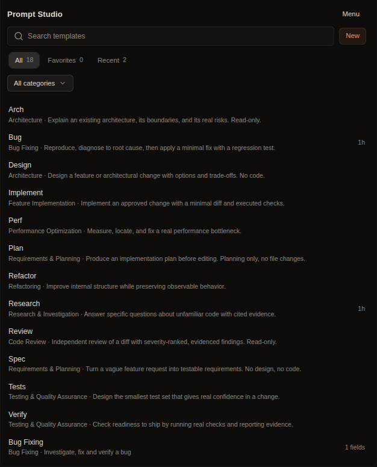

# Prompt Studio

**Your prompts, one click from the composer.**

Prompt Studio is a prompt library for [OpenChamber](https://openchamber.dev). Keep
reusable prompts as templates with fields, categories, and tags. Open one, fill in
the blanks, edit the result, and place it in the chat input — without sending it.

[](https://docs.openchamber.dev/extensions/)
[](https://github.com/AlirezaGhadyani/prompt-studio/actions/workflows/ci.yml)
[](LICENSE)



*The Prompt tab: fill a field, edit the rendered prompt, then replace or append it in the composer.*

## The problem it solves

Reusable prompts end up scattered across snippets, slash commands, chat history,
and notes. Plain snippets cannot ask for a parameter, cannot be categorized, and
cannot show the final text before it is sent. Copying from another document breaks
the flow and loses placeholders.

Prompt Studio makes prompts first-class:

- **One library** instead of three half-libraries.
- **Fields** so `{{feature}}` becomes a real input, not a find-and-replace chore.
- **A preview** of the exact text that will reach the model.
- **A deliberate insert**: replace the draft, append to it, or copy it. Nothing is
  ever sent for you.

## Features

### Library

- Search by name, description, and tags.
- Tabs for **All**, **Favorites**, and **Recent** (the last 12 used).
- Ten built-in categories, plus your own. Deleting a category moves its templates
  to **General**; it never deletes them.
- Favorite, reorder, duplicate, and delete with one-step **Undo**.
- **Load starter templates** adds 12 engineering prompts on demand. A fresh
  install starts empty.



*The library: search, categories, favorites, and recent prompts in the rail panel.*

### Templates

Each template has a name, description, category, tags, a canonical body, and
optional fields.

| Tab | What it holds | Effect |
|---|---|---|
| **Prompt** | The working text | Used for this insertion only; saved only when you ask |
| **Template** | Name, category, tags, fields, canonical body | Saved with **Save changes** |

The body can contain `{{field_key}}` placeholders. The Prompt tab starts with the
field defaults substituted. Editing a field re-renders the prompt until you edit
the prompt by hand; after that, **Apply fields** is the explicit way to re-render.

### Composer integration

- **Replace composer** replaces the current draft; **Append** adds after it.
- **Copy** is the fallback and the only action when no chat is open.
- An empty prompt, no open chat, or a prompt over **16,000 characters** is refused
  with a clear message. Text is never silently truncated.
- The panel never calls `prompt({ send: true })`, `startSession`, or any command.

### Import and export

- Export all, the current filter, or one template as JSON.
- Import pasted JSON or a `.json` file.
- Duplicate policy is explicit: **Skip** (default), **Import as a copy**, or
  **Replace** after confirmation.
- Categories named in the file are created when missing.

<details>
<summary>Export format (version 1)</summary>

```json
{
  "format": "prompt-studio",
  "version": 1,
  "exportedAt": "2026-11-08T00:00:00.000Z",
  "categories": [{ "id": "bugs", "name": "Bug Fixing" }],
  "templates": [
    {
      "id": "t-…",
      "name": "Bug Fix",
      "description": "…",
      "categoryId": "bugs",
      "body": "…{{request}}…",
      "fields": [{ "key": "request", "label": "Request", "required": true, "kind": "multiline" }],
      "tags": ["bug"],
      "favorite": false,
      "order": 4,
      "createdAt": "…",
      "updatedAt": "…",
      "revision": 1
    }
  ]
}
```

</details>

## Install

Requires **OpenChamber 2.7 or newer**, on the web or desktop app. OpenChamber
extensions do not run in the VS Code extension or on mobile.

### Install from GitHub

Open the [**Prompt Studio install page**](https://alirezaghadyani.github.io/prompt-studio/) and choose **Open in OpenChamber**. The page hands off to the app with the repository already filled in.

Or manually:

1. Open **Settings → Extensions**.
2. Paste this into the **Add** field:

   ```
   https://github.com/AlirezaGhadyani/prompt-studio.git
   ```

3. Select **Add**.

Prompt Studio requests no permissions, so no permission dialog appears.

To pin the tagged release instead of following `main`, append `#v1.0.0` to the Git URL.

Git installs can update themselves. **Settings → Extensions** checks at most once
an hour; choose **Check for updates** to check now. The update keeps your templates.

### Install from a folder (development)

1. Clone the repository and build:

   ```sh
   git clone https://github.com/AlirezaGhadyani/prompt-studio.git
   cd prompt-studio
   npm ci
   npm run build
   ```

2. In OpenChamber, open **Settings → Extensions**.
3. Paste the absolute path of the folder and choose **Add**.

A folder install runs from that folder, so a rebuild appears after reopening the
panel. Folder installs do not use OpenChamber's update button.

## Permissions and privacy

Prompt Studio declares **no OpenChamber capabilities**.

| Area | Access |
|---|---|
| Network | None |
| Files on disk | None |
| Send messages / start sessions | None |
| Read conversations | None |
| Storage | Its own extension storage on the connected server |

It can read the current project and session state so it can tell whether a chat is
open, and it can write into that chat's composer when you press a button. It cannot
send. Removing the extension deletes its stored library.

## How it works

```
OpenChamber
  └─ Prompt Studio panel (sandboxed iframe)
       ├─ host.storage  ──► templates, categories, index
       ├─ host.compose  ──► replace or append in the chat box
       └─ host.writeClipboard ──► Copy fallback
```

- **Panel**: one built `panel/main.js` (IIFE) and `panel/index.html`. No framework,
  no runtime module loader, no network.
- **Storage**: `host.storage`, instance scope, under the extension's namespace.
  Writes are sequential, and the index is split so the library is not limited by
  the host's 64 KiB per-value limit. A template too large for one value is rejected
  with a message instead of being truncated.
- **Composer**: `host.compose({ text, mode })` writes into the session's draft.
  Copy uses `host.writeClipboard`, which stops at 32,000 characters; above that the
  dialog offers **Select all** so you can copy manually.

Storage keys:

| Key | Value |
|---|---|
| `meta` | Schema version, categories, index chunk count |
| `idx:0…n` | Index entries (name, description, category, tags, favorite, dates) |
| `t:<id>` | The full template, including body and fields |

Storage is per server and survives reloads. It is deleted when the extension is
removed. The filesystem is never touched, so the panel cannot read snippets or
commands from disk; use the import dialog instead.

## Quick start

1. Install the extension and open **Prompt Studio** from the right rail.
2. Open the **Menu** and choose **Load starter templates**.
3. Pick a template, for example **Bug Fixing**.
4. Fill the **Request** field. The prompt updates as you type.
5. Choose **Replace composer** or **Append**, then finish and send the message
   yourself.

To save your own, choose **New**, write the body on the **Template** tab, use
**Add {{field}}** to create inputs, and select **Save changes**.

The rail panel is compact by design. The same page opens full-screen from
**Extension pages** above the session list, with the library and editor side by
side.

## Development

```sh
npm ci
npm run typecheck   # tsc --noEmit
npm test            # node:test, 34 tests
npm run build       # esbuild → panel/main.js (classic IIFE)
npm run check       # all three
```

```
src/main.ts              host connection, theme, mount once
src/state/store.ts       UI state and actions; insert guards
src/storage/library.ts   CRUD, index chunks, import/export, categories
src/templates/schema.ts  types, validation, placeholder rendering
src/templates/starter.ts the 12 starter prompts
src/ui/app.ts            shell, filters, list, notices
src/ui/editor.ts         Prompt and Template tabs
src/ui/dialogs.ts        import, export, categories, fields, confirmations
scripts/build.mjs        esbuild configuration
test/                    unit tests for the pure modules
```

Only `package.json`, `panel/index.html`, and `panel/main.js` ship to OpenChamber.
`node_modules` is not shipped or read at runtime. The built file is committed
because OpenChamber never builds at install time.

To ship an update: bump `version` in `package.json`, run `npm run check`, commit
the source and the rebuilt `panel/main.js`, and push.

## Limitations

- The rail panel is narrow. Long prompts are comfortable in the full-screen page,
  not in the 380 px rail.
- The sandbox has no downloads and no `navigator.clipboard`; export uses a textarea
  and `host.writeClipboard`.
- Search covers names, descriptions, and tags, not prompt bodies.
- Reordering moves one slot at a time; there is no drag and drop.
- Multi-window edits are last-write-wins at the storage layer; the panel does not
  merge two simultaneous edits.

## Troubleshooting

**The rail icon does not appear.** Check **Settings → Extensions** for an error
card. The manifest must parse. Run `npm run check` in the folder to validate it
against the SDK.

**The panel is blank.** Open OpenChamber in the browser and check the console. The
sandbox reports a failed `main.js` load there.

**"Open a chat first".** The composer belongs to a session. Open a session, then
insert again.

**Changes do not show after a rebuild.** Reload the panel; a folder install reads
`panel/main.js` on load, and the browser may keep the old frame until it is closed
and reopened.

**A template will not save.** It may be larger than the host's 64 KiB value limit.
The message says so; split it into two templates or shorten the body.

## Contributing

Issues and pull requests are welcome. Read [CONTRIBUTING.md](CONTRIBUTING.md) and
run `npm run check` before opening a pull request. For security reports, use
[SECURITY.md](SECURITY.md).

## Related

- [OpenRouter Manager](https://github.com/AlirezaGhadyani/openrouter-manager) — control which OpenRouter provider serves each model.

## License

MIT © Alireza Ghadyani
